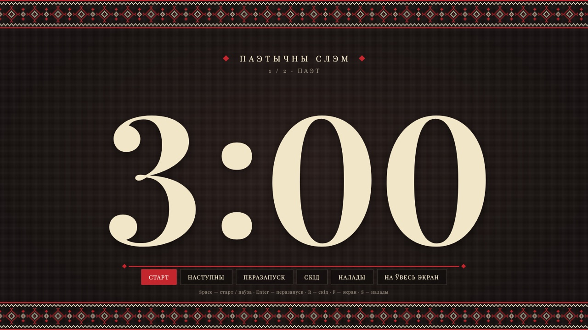
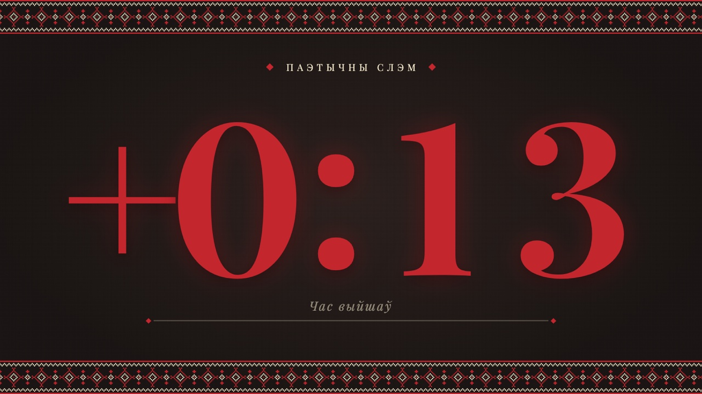
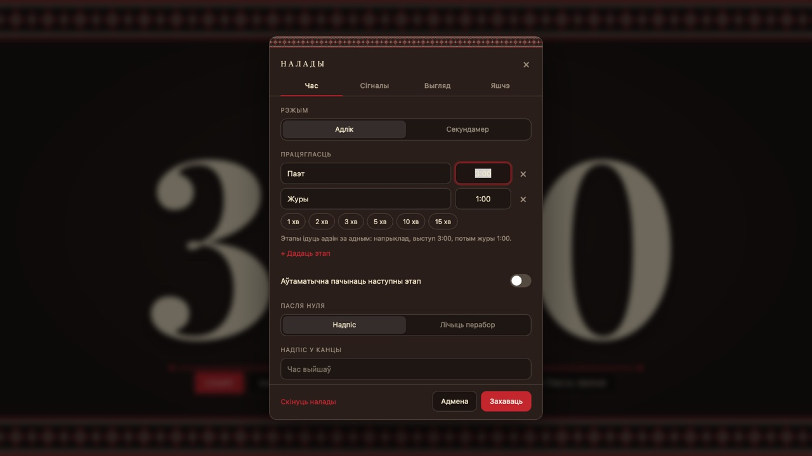
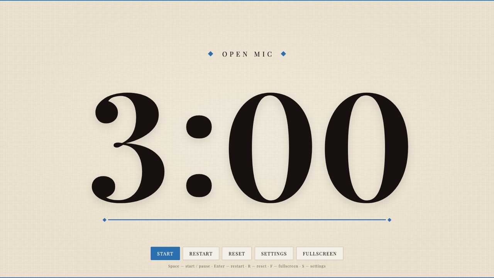

# Stage Timer

[Беларуская](README.md) · [English](README.en.md)

A fullscreen timer for poetry slams, open mics, pitch sessions, debates and any stage performance with a time limit. Big digits readable from the back row, an ornament in the style of Belarusian embroidery (vyshyvanka), warnings before the end and a signal when time is up. Works offline, installs as an app, and is configurable from a link.

**Live:** https://timer.itbeard.com


| Light theme | Final seconds | Time's up |
|---|---|---|
|  |  |  |

| Stages | Overtime | Settings |
|---|---|---|
|  |  |  |

The interface is Belarusian by default and can be switched to English in settings or with `?lang=en`. The screenshots show the Belarusian version; a plain look without the ornament and with a custom accent color is shown below.



## Features

- **Huge digits** that fill the screen, with a progress "thread" underneath that shortens as time passes. Up to 9:59:59.
- **Warnings.** Any number of thresholds, for example 60 and 15 seconds: earlier ones turn the digits gold, the last one turns them red and pulsing with three beeps.
- **Time's up:** a message ("Time out" by default, or your own) and five beeps. Or overtime mode: after zero the digits turn red and count up, "+0:13", so the judges can see how far the performer went over.
- **Pause is visible from the hall:** the digits dim and the colon blinks.
- **Stages.** Several segments in a row, for example performance 3:00 and judges 1:00, with names and optional automatic advance.
- **Stopwatch** with signals at marks.
- **Sound and light.** Volume, a tick during the last ten seconds, a screen flash at the end for noisy rooms, mute on `M`. Signals are scheduled ahead in the audio context, so they play on time even when the tab is in the background.
- **Quick time entry:** digit keys `1`–`9` set minutes, arrow keys add or remove time, including while the timer is running.
- **Link with settings.** One button copies a URL that opens the timer with the same settings on any device. Handy for bookmarks per event format.
- **Audience screen.** A second window without controls for the projector; control from the first one. The windows stay in sync on their own.
- **Look.** Dark, light or system theme, a custom accent color, and the ornament can be switched off for a neutral look. Custom on-screen title.
- **Interface language:** Belarusian by default, English can be selected in settings.
- **Offline and installable.** Fonts are bundled, a service worker caches everything; the timer can be installed as an app from the browser and opened without a network.
- **Accurate timing** based on `performance.now()`, the screen stays on while counting (Wake Lock), shortcuts work in any keyboard layout, settings persist in the browser.
- **No dependencies, no build step:** HTML, CSS and JS. Sounds are synthesized with Web Audio; the ornament is generated as SVG from a text cross-stitch chart.

## Keys

| Key | Action |
|---|---|
| `Space` | Start / pause |
| `Enter` | Restart the current stage |
| `R` | Reset |
| `Shift` + `R`, `Home` | Back to the first stage |
| `N`, `PageDown` | Next stage |
| `P`, `PageUp` | Previous stage |
| `1`…`9`, `0` | Quick minutes (`0` = 10) while the timer is stopped |
| `↑` / `↓` | ± 1 minute |
| `←` / `→` | ± 10 seconds |
| `M` | Mute / unmute |
| `F` | Toggle fullscreen |
| `S` or `,` | Settings |
| `Esc` | Close settings |

Arrow keys change the stage duration while the timer is stopped and the remaining time while it is running. Shortcuts are bound to physical key positions, so `R`, `F` and `S` work in Cyrillic layouts too.

## Link with settings

Everything in the settings dialog can be set with URL parameters. The "Copy link with these settings" button builds the link for you, but you can also write it by hand:

```
https://timer.itbeard.com/?seq=Poet=3:00,Judges=1:00&warn=60,15&over=1&lang=en
```

| Parameter | Example | Effect |
|---|---|---|
| `t` | `t=3:00` | duration: `3` means three minutes, `0:30`, `1:30:00` |
| `seq` | `seq=Poet=3:00,Judges=1:00` | stages, names optional: `seq=3:00,1:00` |
| `auto` | `auto=1` | start the next stage automatically |
| `over` | `over=1` | count overtime after zero |
| `end` | `end=Thank+you!` | end message |
| `warn` | `warn=60,15` | warnings, seconds before the end; `warn=` with no value disables them |
| `sound` | `sound=0` | disable all sounds; separately `warnsound=0`, `endsound=0` |
| `tick` | `tick=1` | tick during the last 10 seconds |
| `flash` | `flash=1` | flash the screen at the end |
| `vol` | `vol=50` | volume, 0–100 |
| `title` | `title=Open+mic` | on-screen title |
| `theme` | `theme=light` | `dark`, `light` or `system` |
| `accent` | `accent=2a6fb0` | accent color |
| `orn` | `orn=0` | no ornament |
| `lang` | `lang=en` | interface language: `be` or `en` |
| `mode` | `mode=stopwatch` | stopwatch; `warn` then means marks from the start |
| `display` | `display` | audience screen without controls or sound |

Parameters apply to the current session and are saved when you press "Save" in settings.

## Running an event

1. Open https://timer.itbeard.com on the laptop connected to the projector or TV.
2. Press `S`, set the time limit and check the sound with "Test".
3. Press `F` to go fullscreen. Controls and cursor hide after three seconds on their own.
4. Before each performer: `Enter` to restart or `Space` to start. Gave the performer an extra half minute: press `→` three times.

Two screens: in settings press "Open audience screen", drag the new window to the projector and press `F` there. Control from the first window: state syncs instantly, sound plays only in the control window.

Tips:

- Browsers do not play audio until the page has received at least one click or key press. The first `Space` unlocks it, but test the sound beforehand.
- In a noisy room enable "Flash the screen at the end": five beeps can drown in applause.
- Safari on iPhone does not support fullscreen for web pages. Add the timer to the home screen and it opens without browser chrome. iPad, Android and desktops work fine.

## Running locally and offline

Download the repository and open `index.html` in a browser. No server and no build step are needed.

```bash
git clone https://github.com/it-beard/timer.git
open slam-timer/index.html
```

The live version works offline after the first visit: a service worker caches the page, scripts and fonts. In Chrome, Edge and Safari the timer can be installed as an app from the browser menu.

To host your own copy, fork the repository and enable GitHub Pages for the `main` branch (Settings → Pages).

## Customizing

- **Colors** are CSS variables in `:root` and `:root[data-theme="light"]` at the top of `style.css`.
- **Ornament** is the `MOTIF` array in `script.js`: `#` is the main color, `o` the secondary color, `.` is empty. The chart repeats horizontally.
- **Defaults** are in the `DEFAULTS` object in `script.js`.
- **Languages** live in `strings.js`. Copy the `en` block, translate it and add an `<option>` in `index.html`.
- **Releases:** after changing files, bump `VERSION` in `sw.js`, otherwise browsers with a cached copy will see the new version only after the cache refreshes.

## Structure

```
index.html             markup and the settings dialog
style.css              styles, themes, animations
script.js              timer, sound, ornament, keyboard, settings, window sync
strings.js             interface translations
sw.js                  service worker for offline use
manifest.webmanifest   web app manifest
fonts/                 Playfair Display (OFL)
icons/                 app icons
screenshots/           screenshots for this README
```

## Browser support

A modern browser is required: Chrome and Edge 111+, Firefox 113+, Safari 16.4+. Wake Lock works in Chrome, Edge, Safari 16.4+ and Firefox 126+. In other browsers the timer still works, but the screen may turn off after the system timeout.
