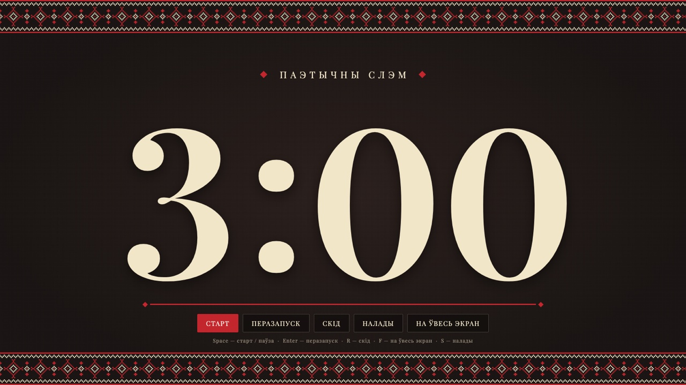
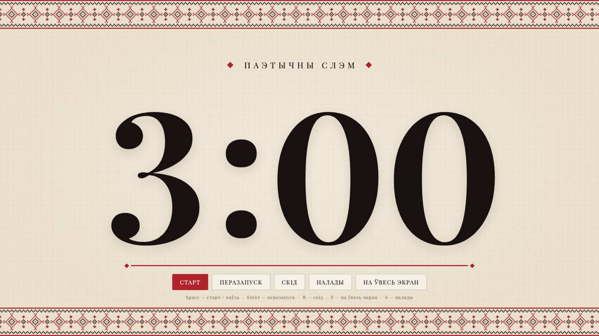
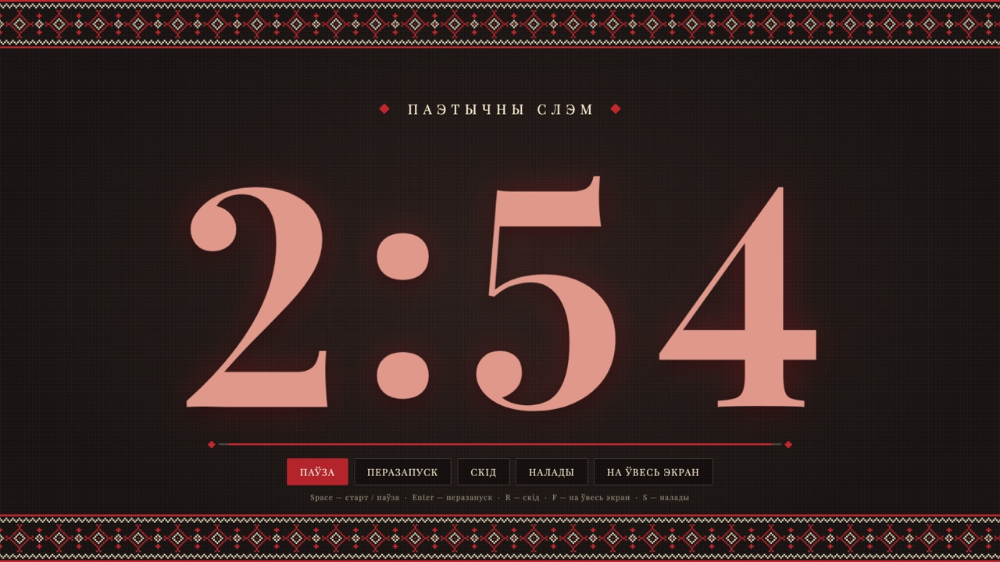
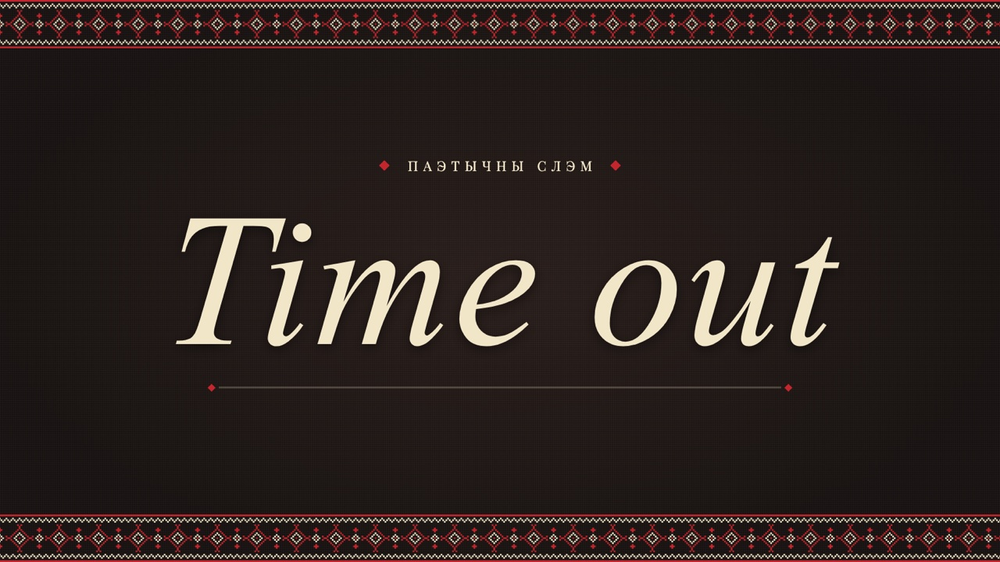

# Таймер для паэтычнага слэму

[Беларуская](README.md) · [English](README.en.md)

Паўнаэкранны таймер зваротнага адліку для паэтычных слэмаў, адкрытых мікрафонаў, пітчаў і любых выступаў з рэгламентам. Вялікія лічбы, якія відаць з апошняга рада, арнамент у стылі вышыванкі, папярэджанне перад канцом і сігнал, калі час скончыўся.

**Жывая версія:** https://timer.itbeard.com



| Светлая тэма | Апошнія секунды | Час выйшаў |
|---|---|---|
|  |  |  |

## Магчымасці

- **Вялікія лічбы** на ўвесь экран і «нітка» пад імі, якая карацее разам з часам.
- **Папярэджанне** за зададзеную колькасць секунд да канца (тыпова 15): лічбы робяцца чырвонымі і пульсуюць, гучаць тры кароткія «пікі».
- **Канец часу:** надпіс *Time out* і пяць «пікаў».
- **Налады** без перазагрузкі старонкі: працягласць да 99:59, момант папярэджання, гукі, загаловак на экране, цёмная ці светлая тэма. Налады захоўваюцца ў браўзеры.
- **Кіраванне з клавіятуры** па фізічных клавішах, таму працуе ў любой раскладцы.
- **Кнопкі і курсор хаваюцца** праз тры секунды бяздзейнасці. На экране застаецца толькі таймер.
- **Экран не гасне** падчас адліку (Wake Lock API).
- **Дакладны адлік.** Час лічыцца ад `performance.now()`, таму таймер не «плыве» і правільна дабірае час, калі ўкладка была ў фоне.
- **Без залежнасцей і зборкі:** адзін HTML, адзін CSS, адзін JS. Гукі сінтэзуюцца праз Web Audio, арнамент генеруецца ў SVG з тэкставай схемы вышыўкі.

## Клавішы

| Клавіша | Дзеянне |
|---|---|
| `Space` | Старт / паўза |
| `Enter` | Перазапуск (скід і адразу старт) |
| `R` | Скід |
| `F` | На ўвесь экран і назад |
| `S` або `,` | Налады |
| `Esc` | Закрыць налады |

Клавішы спрацоўваюць па фізічным размяшчэнні, таму `R`, `F` і `S` працуюць і ў беларускай ці рускай раскладцы.

## Як карыстацца на мерапрыемстве

1. Адкрыйце https://timer.itbeard.com на ноўтбуку, падключаным да праектара ці тэлевізара.
2. Націсніце `S`, задайце рэгламент (напрыклад, 3:00 і папярэджанне за 15 секунд) і праверце гук кнопкай «Праверыць гук».
3. Націсніце `F`, каб разгарнуць таймер на ўвесь экран.
4. Перад кожным выступоўцам: `Enter` для перазапуску або `Space` для старту.

Парады:

- Браўзеры не прайграюць гук, пакуль на старонцы не было хоць аднаго кліку ці націску клавішы. Першы `Space` гэта разблакуе, але лепш праверыць гук загадзя.
- Шрыфт Playfair Display грузіцца з Google Fonts. Без інтэрнэту таймер працуе, але лічбы будуць у сістэмным шрыфце з засечкамі.
- На iPhone Safari не падтрымлівае поўнаэкранны рэжым для вэб-старонак. На iPad, Android і дэсктопах усё працуе.

## Запуск лакальна

Спампуйце рэпазіторый і адкрыйце `index.html` у браўзеры. Сервер і зборка не патрэбныя.

```bash
git clone https://github.com/it-beard/slam-timer.git
open slam-timer/index.html
```

Каб размясціць сваю копію, зрабіце форк і ўключыце GitHub Pages для галіны `main` (Settings → Pages).

## Як змяніць пад сябе

- **Колеры** — зменныя ў `:root` і `:root[data-theme="light"]` у пачатку `style.css`.
- **Арнамент** — масіў `MOTIF` у `script.js`: `#` асноўны колер, `o` дадатковы, `.` пуста. Схема паўтараецца па гарызанталі.
- **Тыповыя налады** (час, папярэджанне, загаловак) — аб'ект `DEFAULTS` у `script.js`.
- **Тэксты інтэрфейсу** — у `index.html`, а подпісы кнопкі старту ў функцыі `setStatus` у `script.js`.

## Структура

```
index.html   разметка і дыялог наладаў
style.css    стылі, тэмы, анімацыі
script.js    таймер, гук, арнамент, клавіятура, налады
```

## Падтрымка браўзераў

Патрэбны сучасны браўзер з падтрымкай `<dialog>`: Chrome і Edge 37+, Firefox 98+, Safari 15.4+. Wake Lock працуе ў Chrome, Edge, Safari 16.4+ і Firefox 126+. У іншых браўзерах таймер працуе, але экран можа згаснуць па сістэмным таймаўце.
